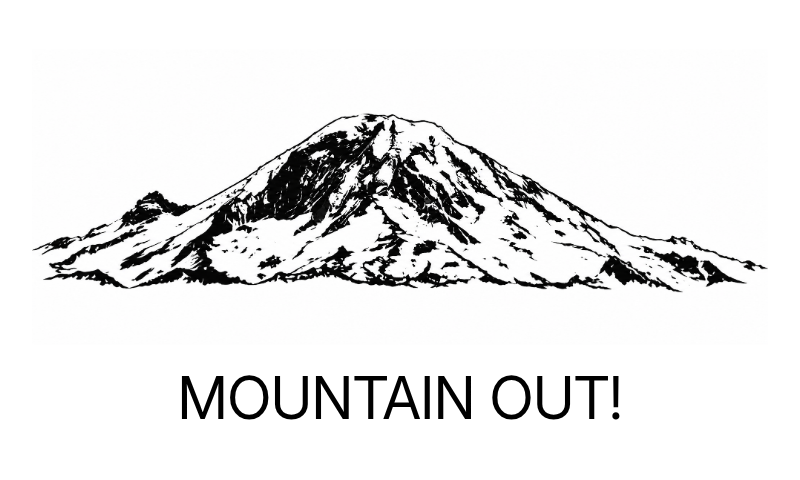

# Is the Mountain Out?

A TRMNL recipe for a familiar Northwest question: **is the mountain out?**
Viewpoint-specific Rainier or Hood artwork fills the screen, with five weather-based verdicts
and an honest **UNKNOWN** state. Defaults to Mount Rainier from Seattle’s Kerry Park. Choose Tacoma or Paradise
for Rainier, or Mount Hood from Portland.



This is Phase 1: an **uncalibrated estimate for the configured observation area**.
Seattle uses four weather samples along the approximately 98 km viewing corridor,
including near Rainier, with a distance-dependent haze penalty. This is an
uncalibrated Seattle estimate, not a confirmed view. Terrain, cloud heights,
darkness and webcam verification are not modelled. Paradise retains the local model.
The preset selects both weather geometry and viewpoint-specific generated artwork.

## Run

Python 3.11+ with system timezone data is sufficient. No API key or runtime packages.

```sh
cd /workspace/is_the_mountain_out
python -m mountain.server
```

The service listens on loopback port 8080. `/health` checks the server process;
`/api/visibility` performs the actual weather workflow. An omitted or blank viewpoint selects Seattle. Unknown viewpoints and legacy
coordinate/name overrides receive HTTP 400 to prevent mismatched images and geometry.

```sh
curl --fail 'http://127.0.0.1:8080/api/visibility?viewpoint=seattle'
```

Provider failures return HTTP 200 with `status: unknown` so TRMNL can still render a
useful neutral screen. No previous good verdict is served after a failed refresh.
Other routes receive HTTP 404. See [model and data contract](docs/model.md).

## Install on TRMNL

1. Deploy the Python service on an always-on host with outbound HTTPS access to
   `api.open-meteo.com`. Run `python -m mountain.server --host 0.0.0.0 --port 8080`
   behind your normal TLS reverse proxy and process supervisor. The stdlib HTTP
   server is a small origin service, not an Internet-facing production gateway;
   configure request limits/rate limits at the proxy. No secrets are required.
2. Create a Private Plugin using **Polling**, GET, and a 15-minute refresh.
   Apply the settings in [plugin/src/settings.yml](plugin/src/settings.yml), pinned
   to Framework **3.4.0**. Fill in your service's public HTTPS origin (no trailing
   slash), and select the mountain. The conditional Rainier dropdown offers **Seattle — Kerry Park**,
   **Tacoma — Ruston Way**, and **Paradise**; the Hood dropdown offers
   **Portland — Pittock Mansion**. Only the chosen mountain’s dropdown is shown.
   Replace older recipe fields/polling URLs with `mountain`, `rainier_viewpoint`,
   and `hood_viewpoint`; the default remains Rainier/Seattle.
3. Paste `shared.liquid` into Shared, `full.liquid` into Full, and the corresponding
   half and quadrant templates into their layout tabs. These are Liquid snippets;
   the TRMNL host provides the Framework and outer screen wrapper.
4. Set the polling URL from `settings.yml`, substituting the custom fields via
   TRMNL's Liquid interpolation. If configuring manually, an equivalent fixed URL
   is `https://YOUR-HOST/api/visibility?viewpoint=seattle`.
5. Run the plugin preview on TRMNL, inspect the returned JSON, and add it to your
   device playlist. Confirm Full and your chosen mashup layout before publishing
   the recipe. The backend must be reachable by TRMNL's servers, not just your device.

No TRMNL account access, public deployment, or physical device was supplied for
this build. Hosted rendering and physical e-paper output require this final check.
Framework 3.4.0 is pinned explicitly.

The templates use native Framework layout, spacing and value typography, shared
named templates, and escaped verdict text. There are no custom CSS rules. The
Rainier images are generated illustrations, not photographs. The Seattle artwork
was revised using the user-supplied Seattle photograph as a perspective reference:
a broad domed summit with Little Tahoma far to the left. It is not a surveyed tracing. The API selects one of four mountain/viewpoint image assets. Native Framework
layout, spacing and typography surround an SVG scene that embeds the artwork
and an opaque monochrome ink-engraved cloud-bank texture. All layouts show only the mountain above the verdict.
The clear verdict reads MOUNTAIN OUT!; other states, including UNKNOWN, remain honest.
Weather-estimate limitations, timestamps and attribution remain in the API and
documentation rather than on the deliberately minimal screen.

## Development and validation

```sh
python -m venv .venv
.venv/bin/pip install -r requirements-dev.txt
.venv/bin/python -m unittest discover -s tests -v
.venv/bin/python tools/preview.py
.venv/bin/python tools/check_layouts.py
```

The browser check uses `/usr/bin/chromium` and requires local process/socket access.
The 29 tests cover model boundaries, mixed conditions, missing/stale/invalid data,
cache expiry, error recovery, observer changes, HTTP responses, Liquid escaping,
missing data, and all 96 mountain/viewpoint/state/layout combinations. The preview harness adapts
TRMNL's named `template` wrapper to a standard Liquid partial and uses official
Framework 3.4.0 CSS and fonts. It does **not** substitute for the hosted renderer.

For the official preview tool, install [trmnlp](https://github.com/usetrmnl/trmnlp),
start this service, then run `trmnlp serve` from `plugin/`. Its local custom fields
are supplied in `.trmnlp.yml`. This optional Ruby tool is not required by the service.

## Maintenance

Keep the origin running under a supervisor, terminate TLS at the gateway, and
monitor `/api/visibility` as well as `/health`: process health does not prove
upstream weather availability. Only expose this public-data API, never environment
configuration or credentials. Cache size is bounded to 128 coordinate pairs; valid
responses are reused for 15 minutes and transport failures back off for one minute.
Caches are in memory and intentionally disappear on restart. Multiple processes
have independent caches; use one worker for a small personal deployment.

Check [Open-Meteo's terms](https://open-meteo.com/en/terms) before deployment:
the free endpoint is for eligible non-commercial use and has usage limits. A
commercial deployment needs an appropriate plan rather than assuming free access.
The API and recipe documentation attribute Open-Meteo. Tune thresholds only after observation-based
calibration, preserving UNKNOWN behavior and the documented estimate limitation.

If this backend is unreachable, TRMNL may retain an older rendered screen. The minimal screen no longer prints timestamps; inspect the API timestamps and
TRMNL refresh status before relying on a retained image. The service cannot replace a
screen while TRMNL cannot reach it. It never guarantees device refresh delivery.

Future terrain and webcam work is scoped in [research notes](docs/research.md).

Browser validation caches the official 3.4.0 CSS and fonts under `.venv/framework/`.
To refresh that cache, clone `https://github.com/usetrmnl/trmnl-framework.git` outside
the checkout and copy `public/css/3.4.0/plugins.css` and `public/fonts/` there.
The browser harness intercepts asset requests to use these unmodified local files.

## Seattle model limitations

The corridor model is intentionally conservative. The poorest cloud/precipitation
verdict among four samples limits the result, then a distance/visibility index may
reduce it further. Read [the precise thresholds](docs/model.md#seattle-corridor).
Surface visibility is not visibility along an elevated ray to the summit. Forecast
visibility often has a provider/model ceiling: a reported 24 km must not be treated
as proof Rainier is hidden 98 km away. This initial heuristic can underpredict a
clear mountain above haze or cloud; it needs independent Seattle-view calibration.
No such calibration has been performed, and no reliability rate is claimed.

## Mountains, viewpoints and display states

| Mountain | Location preset | Approximate observer coordinates | API |
| --- | --- | --- | --- |
| Rainier / Tahoma | Seattle — Kerry Park (default) | 47.6295, -122.3599 | `?mountain=rainier&viewpoint=seattle` |
| Rainier / Tahoma | Tacoma — Jack Hyde Park, Ruston Way waterfront | 47.2809, -122.4608 | `?mountain=rainier&viewpoint=tacoma` |
| Rainier / Tahoma | Paradise | 46.786, -121.735 | `?mountain=rainier&viewpoint=paradise` |
| Hood / Wy’east | Portland — Pittock Mansion | 45.5252, -122.7163 | `?mountain=hood&viewpoint=portland` |

The named points are approximate fixed observers, not claims that all places in a
city share identical visibility. Tacoma and Portland use the same four-point
corridor/weather heuristic as Seattle, with their own observer, target summit,
route distance, cache entries, model identifier and generated artwork. Hood’s
summit target is 45.3736, -121.6959. Mountain/viewpoint mismatches return HTTP 400.
Omitting `mountain` keeps compatibility with older Rainier API URLs; `mountain=hood`
without a viewpoint defaults to Portland. A hidden saved location field is never
used to construct the other mountain’s polling URL.

The illustration now changes with state: clear mountain, low clouds, half-hidden,
a small summit fragment, fully cloud-obscured, or a neutral dashed outline for
UNKNOWN. Cloud shapes are symbolic estimates, not reconstructed cloud positions. The
shared `/assets/cloud-bank.png` texture uses an opaque white body and transparent
sky, with naturalistic broken ink shading that matches the mountain artwork.
No extra screen text was introduced. Generated artwork is not geographically
surveyed or photographically verified; Tacoma and Hood need local reference review.
All four use the same weather provider destination; no extra secret is needed.

Run `.venv/bin/python tools/render_states.py` to regenerate the four review sheets
and 24 full-resolution full-layout fixtures in `docs/previews/`. The settings use
TRMNL `conditional_validation` with `when`, `required`, and `hidden`, following the
[published form guide and examples](https://github.com/blueset/trmnl-recipes/blob/master/refs/template_guide.md).
Hosted form behavior and physical device rendering still require TRMNL verification.
